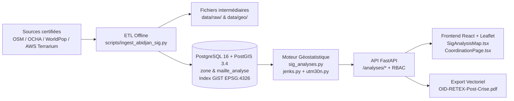

# Guide Technique & Scientifique Complet — Module d'Analyse SIG (O.I.D)

Ce document décrit de façon exhaustive et autonome l'ensemble du module **Analyse SIG & Aide à la Décision** de la plateforme **O.I.D (Observatoire Inondations & Dommages)** : architecture, outils, sources de données, schéma PostGIS, pipeline d'ingestion, projections géodésiques, formules mathématiques et géostatistiques, API REST, interface cartographique interactive et procédure complète de suppression / reconstruction à partir de zéro.

---

## Table des matières

1. [Vue d'ensemble & cartographie des fichiers](#1-vue-densemble--cartographie-des-fichiers)
2. [Outils, bibliothèques et sources de données](#2-outils-bibliothèques-et-sources-de-données)
3. [Systèmes de Référence de Coordonnées (SCR) & Projections (`EPSG:4326` ↔ `EPSG:32630`)](#3-systèmes-de-référence-de-coordonnées-scr--projections-epsg4326--epsg32630)
4. [Modèle de données & migrations PostGIS](#4-modèle-de-données--migrations-postgis)
5. [Pipeline d'ingestion géomatique (`ingest_abidjan_sig.py`)](#5-pipeline-dingestion-géomatique-ingest_abidjan_sigpy)
6. [Utilitaires géomatiques : discrétisation de Fisher-Jenks (`jenks.py`)](#6-utilitaires-géomatiques--discrétisation-de-fisher-jenks-jenkspy)
7. [Moteur d'analyse géostatistique : formules et importance opérationnelle](#7-moteur-danalyse-géostatistique--formules-et-importance-opérationnelle)
   - [7.1 Indice de Vulnérabilité Locale par maille hexagonale ($IV_m$)](#71-indice-de-vulnérabilité-locale-par-maille-hexagonale-iv_m)
   - [7.2 Pondération des sinistres actifs](#72-pondération-des-sinistres-actifs)
   - [7.3 Autocorrélation spatiale locale Getis-Ord $G_i^*$](#73-autocorrélation-spatiale-locale-getis-ord-g_i)
   - [7.4 Corridors d'inondation : `ST_ClusterDBSCAN` + `ST_ConcaveHull`](#74-corridors-dinondation--st_clusterdbscan--st_concavehull)
   - [7.5 Indice composite de vulnérabilité communale UNDRR ($A \times E \times V$)](#75-indice-composite-de-vulnérabilité-communale-undrr-a-times-e-times-v)
   - [7.6 Détection des zones silencieuses : modèle de Poisson ($O_i$ vs $E_i$)](#76-détection-des-zones-silencieuses--modèle-de-poisson-o_i-vs-e_i)
   - [7.7 Rapport post-crise RETEX en PDF (`generer_rapport_retex_pdf`)](#77-rapport-post-crise-retex-en-pdf-generer_rapport_retex_pdf)
   - [7.8 Rappel : dédoublonnage géospatial (`doublons.py`)](#78-rappel--dédoublonnage-géospatial-doublonspy)
8. [API REST FastAPI (`/analyses/*`) & RBAC](#8-api-rest-fastapi-analyses--rbac)
9. [Architecture Frontend (`SigAnalysisMap.tsx`, `CoordinationPage.tsx`, CSS)](#9-architecture-frontend-siganalysismaptsx-coordinationpagetsx-css)
10. [Stratégie de tests & simulation SQLite (`tests/conftest.py`, Lot 1 & Lot 2)](#10-stratégie-de-tests--simulation-sqlite-testsconftestpy-lot-1--lot-2)
11. [Guide pratique : points d'attention pour supprimer puis refaire de zéro](#11-guide-pratique--points-dattention-pour-supprimer-puis-refaire-de-zéro)

---

## 1. Vue d'ensemble & cartographie des fichiers

### 1.1 Genèse et objectifs (Lots 1 & 2)

Le module d'analyse SIG d'O.I.D couvre le **District Autonome d'Abidjan** (10 communes urbaines + 3 communes périphériques = **13 communes**, soit **1 031,24 km²** terrestres et **5 332 136 habitants** selon l'extraction WorldPop 2020 enregistrée dans `data/geo/sources_metadata.json`).

Son objectif est de remplacer les approximations cartographiques classiques (cercles factices centrés sur des centroïdes arbitraires, distances en degrés WGS84) par une **chaîne géomatique et géostatistique rigoureuse** :

- **Calculs métriques exacts** en projection **UTM Zone 30N (`EPSG:32630`)** et stockage normalisé en **WGS 84 (`EPSG:4326`)**.
- **Découpage infra-communal** en mailles hexagonales régulières de **300 m de côté** ($0{,}233827\text{ km}^2$ par hexagone) croisant population WorldPop (100 m), modèle numérique de terrain (MNT) et proximité au réseau hydrographique (Lagune Ébrié, rivières, canaux, drains).
- **Quatre analyses scientifiques complémentaires** :
  1. **Points chauds statistiques** (**Getis-Ord $G_i^*$**) identifiant les regroupements significatifs (90 %, 95 %, 99 %).
  2. **Corridors d'inondation physiques** (**`ST_ClusterDBSCAN` + `ST_ConcaveHull`**) épousant le tracé réel des rues et talwegs inondés.
  3. **Vulnérabilité communale multicritère** selon le cadre **UNDRR** ($IV = A^{0{,}40} \times E^{0{,}35} \times V^{0{,}25}$), classée par **seuils naturels de Fisher-Jenks**.
  4. **Détection des zones silencieuses** par loi de **Poisson ($O_i$ vs $E_i$)** pour repérer les communes très exposées mais anormalement muettes (isolement, coupure réseau/électrique).
- **Restitution double** : interface cartographique interactive **Leaflet (Canvas + SVG)** dans le navigateur et export vectoriel **PDF RETEX**.

### 1.2 Flux architectural de bout en bout

### 1.3 Inventaire exact des fichiers du module SIG

| Couche | Fichier | Rôle exact |
|---|---|---|
| **Modèles ORM** | `app/models/zone.py` | Table `zone` (13 communes, population, superficie, géométrie `MULTIPOLYGON` 4326) |
| **Modèles ORM** | `app/models/maille_analyse.py` | Table `maille_analyse` (hexagones 300 m, WorldPop, hydro, altitude, aléa, `POLYGON` 4326) |
| **Migration DB** | `alembic/versions/c3d4e5f6a7b8_sig_zones_et_mailles_epsg32630.py` | Colonnes enrichies de `zone`, table `maille_analyse` et index spatiaux GiST |
| **Projections** | `app/services/utm30n.py` | Transverse Mercator WGS84 ↔ UTM 30N (`EPSG:32630`) vectorisé NumPy + helper PostGIS |
| **Classification** | `app/services/jenks.py` | Programmation dynamique Fisher-Jenks, GVF exacte et palettes ColorBrewer |
| **Moteur SIG** | `app/services/sig_analyses.py` | Communes, mailles $IV_m$, Getis-Ord $G_i^*$, DBSCAN+ConcaveHull, UNDRR, Poisson, PDF RETEX |
| **Dédoublonnage** | `app/services/doublons.py` | Détection spatiale des doublons (`ST_DWithin` 400 m / 24 h + fallback Haversine) |
| **Routeur API** | `app/routers/analyses.py` | 8 endpoints sous `/analyses` + contrôle d'accès (`coordinateur`, `verificateur`) |
| **Enregistrement API** | `app/main.py` | Montage `app.include_router(analyses.router)` |
| **Script ETL** | `scripts/ingest_abidjan_sig.py` | CLI `fetch`, `process`, `load-db`, `all` pour Abidjan |
| **Données brutes** | `data/raw/*` | JSON Overpass, GeoTIFF WorldPop 2020, tuiles PNG Terrarium z=12 |
| **Données traitées** | `data/geo/*` | GeoJSON 13 communes & hydro, `.npz` WorldPop 100 m & MNT, `sources_metadata.json` |
| **Composant Carte** | `frontend/src/components/SigAnalysisMap.tsx` | Carte Leaflet dual-mode (`operationnel` / `analyse`), Canvas+SVG, tiroirs, légendes, UTM live |
| **Page Coordination** | `frontend/src/pages/CoordinationPage.tsx` | Onglet `analyses` (et réutilisation du composant carte en mode `operationnel` dans `carte`) |
| **Feuilles de style** | `frontend/src/index.css` & `frontend/src/styles/components.css` | Classes `.sig-*` et `.oid-map-*` / `.oid-drawer-*` |
| **Tests SIG** | `tests/test_sig_lot1.py` & `tests/test_sig_lot2.py` | Tests unitaires et d'intégration (UTM, Jenks, GeoJSON, RBAC, Gi*, DBSCAN, UNDRR, Poisson, PDF) |
| **Note historique** | `EXPLICATIONS_SIG_LOT1_LOT2.txt` | Note récapitulative comparant l'architecture avant/après Lots 1 & 2 |

---

## 2. Outils, bibliothèques et sources de données

### 2.1 Base de données & extension spatiale

- **SGBD** : `postgis/postgis:16-3.4` (défini dans `docker-compose.yml`, base `oid`, port `5432`).
- **Fonctions PostGIS utilisées dans le module** :
  - `ST_Transform(geom, 32630)` / `ST_Transform(geom, 4326)` : reprojection métrique à la volée.
  - `ST_HexagonGrid(300.0, ...)` : génération native d'une grille hexagonale régulière sans recouvrement en coordonnées UTM 30N.
  - `ST_ClusterDBSCAN(geom_utm, eps := ..., minpoints := ...) OVER ()` : clustering spatial par densité.
  - `ST_ConcaveHull(ST_Collect(geom_utm), 0.80, false)` : enveloppe géométrique fidèle d'un nuage de points.
  - `ST_Buffer(..., 65.0, 'quad_segs=8')` : dilatation métrique d'emprise de rue (65 m).
  - `ST_Area`, `ST_Perimeter`, `ST_Intersection`, `ST_Intersects`, `ST_PointOnSurface`, `ST_AsGeoJSON`, `ST_Extent`, `ST_SetSRID`, `ST_DWithin(..., true)` (sphéroïde Geography).
  - Index spatiaux **GiST** (`USING gist`) sur `zone.geom` et `maille_analyse.geom`.

### 2.2 Bibliothèques Backend (Python 3.12)

Déclarées dans `requirements.txt` et `requirements-dev.txt` :

| Paquet | Rôle dans le module SIG |
|---|---|
| `fastapi>=0.115`, `uvicorn[standard]>=0.30` | Exposition des endpoints `/analyses/*` et téléchargement du PDF |
| `sqlalchemy>=2.0`, `geoalchemy2>=0.20`, `psycopg[binary]>=3.1` | ORM spatial, binding `Geometry` / `Geography`, requêtes SQL natives PostGIS |
| `alembic>=1.13` | Versionnement du schéma `zone` et `maille_analyse` |
| `shapely>=2.0` | Géométries Python, `STRtree` (index R-tree en mémoire), `concave_hull`, `buffer`, `difference`, fallback SQLite |
| `reportlab>=4.2` | Génération vectorielle A4 du rapport post-crise RETEX (`OID-RETEX-Post-Crise.pdf`) |
| `pytest>=8.2`, `ruff>=0.5`, `httpx>=0.27` | Tests automatisés, linting et client HTTP de téléchargement ETL (`httpx`) |

> [!WARNING]
> **Point de vigilance dépendances (`requirements.txt`) :**
> À l'état actuel du dépôt, **`numpy`** (importé dans `utm30n.py`, `jenks.py`, `sig_analyses.py`, `ingest_abidjan_sig.py`), **`Pillow`** (`PIL`, utilisé dans `ingest_abidjan_sig.py` pour décoder le GeoTIFF WorldPop et les tuiles PNG Terrarium sans GDAL) et **`httpx`** (utilisé pour l'ingestion réseau dans `ingest_abidjan_sig.py`, listé seulement dans `requirements-dev.txt`) ne figurent pas dans `requirements.txt`.
> Lors d'une reconstruction ou d'un build Docker propre (`Dockerfile`), il est indispensable d'ajouter **`numpy`**, **`Pillow`** et **`httpx`** (si l'ETL tourne dans le même environnement) à `requirements.txt`.

### 2.3 Bibliothèques Frontend (TypeScript / React)

Définies dans `frontend/package.json` :
- `react` (`^19.3.1`), `react-dom` (`^19.3.1`), `react-router-dom` (`^7.18.5`)
- `leaflet` (`^1.9.4`) & `@types/leaflet` (`^1.9.21`) : moteur cartographique client avec double renderer `L.canvas` et `L.svg`.
- `lucide-react` (`^1.70.0`) : icônes des panneaux et tiroirs (`Layers`, `Filter`, `BarChart2`, `Search`, `Flame`, `Grid`, `VolumeX`, `Compass`, etc.).

### 2.4 Sources de données géographiques et démographiques externes

| Donnée | Source | Résolution / Détail | Licence | Fallback prévu |
|---|---|---|---|---|
| Limites des 13 communes | **OpenStreetMap Overpass API** | `admin_level` 6 à 9 (priorité 8 > 7 > 6) | ODbL | **OCHA COD-AB** (HDX `civ_admin_boundaries.geojson`) |
| Lagune Ébrié & surfaces d'eau | **OpenStreetMap Overpass API** | `natural=water`, `water=lagoon`, `waterway=riverbank` | ODbL | Surfaces conservées brutes si absent |
| Réseau hydrographique | **OpenStreetMap Overpass API** | `waterway` (`river`, `stream`, `canal`, `drain`, `ditch`) + `natural=coastline` + rives lagunaires | ODbL | — |
| Densité de population | **WorldPop 2020 UN-adjusted Constrained** | GeoTIFF 100 m (`civ_ppp_2020_UNadj_constrained.tif`) | CC-BY 4.0 | — |
| Modèle Numérique de Terrain (MNT) | **AWS Elevation Tiles (Mapzen Terrarium)** | Tuiles PNG RGB **zoom 12** (~38 m après sous-échantillonnage 2×2), dérivées SRTM / Copernicus DEM | Ouvert AWS | — |

**Valeurs réelles extraites dans `data/geo/sources_metadata.json` (généré le `2026-11-06T14:46:35Z`) :**
- `nb_communes` : `13`
- `superficie_terrestre_totale_km2` : `1031.24 km²`
- `population_totale_district` : `5 332 136` habitants
- `hydrographie.nb_troncons` : `1 190` tronçons
- `dem.altitude_min_m` : `0.0 m`, `dem.altitude_max_m` : `190.2 m`, résolution effective ~`38 m`
- `maillage` : hexagones réguliers de côté `300 m`, superficie théorique `0.233827 km²`

---

## 3. Systèmes de Référence de Coordonnées (SCR) & Projections (`EPSG:4326` ↔ `EPSG:32630`)

### 3.1 Pourquoi cette séparation est indispensable

Abidjan est située autour de $5{,}3^\circ\text{ N}$ et $-4{,}0^\circ\text{ O}$. En coordonnées géographiques non projetées (`EPSG:4326`, en degrés), un degré de latitude et un degré de longitude n'ont pas la même longueur métrique et aucun calcul d'aire, de rayon euclidien (450 m, 900 m) ou d'enveloppe régulière ne peut être exact.
Le système applique donc une règle stricte :
1. **Stockage en base et échanges GeoJSON** : toujours en **`EPSG:4326`** (norme RFC 7946 pour Leaflet).
2. **Tous les calculs géométriques, maillages, distances, surfaces et clusters** : toujours projetés en **`EPSG:32630` (WGS 84 / UTM zone 30N)**, exprimé en mètres.

### 3.2 Paramètres géodésiques et formules exactes (`app/services/utm30n.py` & `SigAnalysisMap.tsx`)

Constantes de l'ellipsoïde WGS 84 et de la zone UTM 30N :
- Demi-grand axe : $a = 6\,378\,137{,}0\text{ m}$
- Aplatissement : $f = \frac{1}{298{,}257223563}$
- Première excentricité au carré : $e^2 = 2f - f^2$
- Seconde excentricité au carré : $e'^2 = \frac{e^2}{1 - e^2}$
- Facteur d'échelle au méridien central : $k_0 = 0{,}9996$
- Méridien central (Zone 30N) : $\lambda_0 = -3{,}0^\circ$ ($\approx -0{,}0523598776\text{ rad}$)
- Faux Est : $E_0 = 500\,000{,}0\text{ m}$, Faux Nord (hémisphère Nord) : $N_0 = 0{,}0\text{ m}$

#### Projection directe WGS 84 $(\phi, \lambda) \rightarrow$ UTM 30N $(E, N)$ (Snyder, 1987)

Avec $\phi, \lambda$ en radians :

$$\nu = \frac{a}{\sqrt{1 - e^2 \sin^2\phi}}, \quad T = \tan^2\phi, \quad C = e'^2 \cos^2\phi, \quad A = (\lambda - \lambda_0)\cos\phi$$

L'arc méridien $M(\phi)$ est développé au 6e ordre :

$$M(\phi) = a \left[ \left(1 - \frac{e^2}{4} - \frac{3e^4}{64} - \frac{5e^6}{256}\right)\phi - \left(\frac{3e^2}{8} + \frac{3e^4}{32} + \frac{45e^6}{1024}\right)\sin(2\phi) + \left(\frac{15e^4}{256} + \frac{45e^6}{1024}\right)\sin(4\phi) - \left(\frac{35e^6}{3072}\right)\sin(6\phi) \right]$$

Coordonnées métriques résultantes :

$$E = E_0 + k_0\,\nu \left[ A + (1 - T + C)\frac{A^3}{6} + (5 - 18T + T^2 + 72C - 58e'^2)\frac{A^5}{120} \right]$$

$$N = N_0 + k_0 \left[ M + \nu\tan\phi \left( \frac{A^2}{2} + (5 - T + 9C + 4C^2)\frac{A^4}{24} + (61 - 58T + T^2 + 600C - 330e'^2)\frac{A^6}{720} \right) \right]$$

Le module `utm30n.py` fournit également la transformation inverse exacte (`utm30n_to_wgs84`) via l'attitude rectifiée $\mu$, la latitude d'empreinte $\phi_1$ (série en $e_1 = \frac{1 - \sqrt{1-e^2}}{1 + \sqrt{1-e^2}}$), ainsi que les helpers `geom_to_utm30n`, `geom_to_wgs84`, `area_km2_utm30n` et `distance_m_utm30n` utilisés lorsque SQLite remplace PostGIS en test unitaire. Le même algorithme direct est dupliqué côté frontend TypeScript (`wgs84ToUtm30N` dans `SigAnalysisMap.tsx`) pour afficher les coordonnées métriques sous le curseur sans appel serveur.

---

## 4. Modèle de données & migrations PostGIS

### 4.1 Tables impliquées dans l'analyse SIG

#### Table `zone` (`app/models/zone.py`)
Créée à l'origine en Tranche 1 (`762aa75c49bc`), puis enrichie pour le SIG par `c3d4e5f6a7b8` :

| Colonne | Type SQL / ORM | Description |
|---|---|---|
| `id` | `Integer` (PK) | Identifiant interne de la commune |
| `nom` | `String(120)` NOT NULL | Nom officiel (ex. `Cocody`, `Yopougon`) |
| `code_adm` | `String(32)` nullable | Code normalisé `CIV-ABJ-001` … `CIV-ABJ-013` |
| `population_totale` | `Float` NOT NULL (`0.0`) | Population estimée WorldPop 100 m |
| `superficie_km2` | `Float` NOT NULL (`0.0`) | Superficie terrestre réelle en `EPSG:32630` (hors lagune) |
| `densite_hab_km2` | `Float` NOT NULL (`0.0`) | $\text{population\_totale} / \text{superficie\_km2}$ |
| `source_geom` | `String(160)` nullable | Traçabilité source (ex. `OSM Overpass / HDX COD-AB + WorldPop 2020 (EPSG:32630)`) |
| `geom` | `Geometry("MULTIPOLYGON", srid=4326)` | Contour polygonal terrestre de la commune |

#### Table `maille_analyse` (`app/models/maille_analyse.py`)
Créée intégralement par la migration `c3d4e5f6a7b8_sig_zones_et_mailles_epsg32630.py` :

| Colonne | Type SQL / ORM | Description |
|---|---|---|
| `id` | `Integer` (PK) | Identifiant de la maille |
| `code_maille` | `String(40)` UNIQUE NOT NULL | Code grille `HEX300-{i}-{j}` |
| `zone_id` | `Integer` FK → `zone.id` (indexé) | Commune d'appartenance (intersection spatiale maximale) |
| `cote_m` | `Integer` NOT NULL (`300`) | Côté de l'hexagone régulier en mètres (`EPSG:32630`) |
| `superficie_km2` | `Float` NOT NULL (`0.233827`) | Superficie de l'hexagone réel en $\text{km}^2$ (`EPSG:32630`) |
| `population_worldpop` | `Float` NOT NULL (`0.0`) | Population désagrégée issue de WorldPop 100 m |
| `densite_hab_km2` | `Float` NOT NULL (`0.0`) | Densité locale ($\text{population\_worldpop} / \text{superficie\_km2}$) |
| `dist_hydro_m` | `Float` nullable | Distance euclidienne UTM au tronçon hydro/lagune le plus proche (m) |
| `altitude_moy_m` | `Float` nullable | Altitude moyenne MNT Terrarium autour du centroïde (m) |
| `indice_alea` | `Float` nullable | Aléa physique inondation `[0..100]` |
| `geom` | `Geometry("POLYGON", srid=4326)` NOT NULL | Polygone hexagonal en WGS 84 |

### 4.2 Index spatiaux et justification de la grille hexagonale

La migration `c3d4e5f6a7b8` crée deux index **GiST** sur PostgreSQL :
- `ix_maille_analyse_geom_gist` sur `maille_analyse(geom)`
- `ix_zone_geom_gist` sur `zone(geom)`

**Pourquoi un maillage hexagonal régulier de 300 m ?**
- Contrairement aux carreaux carrés (où les 4 voisins diagonaux sont à $\sqrt{2}d$ et les 4 adjacents à $d$), l'hexagone garantit **l'isotropie spatiale** : ses **6 voisins directs ont tous la même distance entre centroïdes** ($\sqrt{3}\,c \approx 519{,}6\text{ m}$ pour $c = 300\text{ m}$), ce qui réduit les biais géométriques dans les calculs d'autocorrélation spatiale ($G_i^*$).
- La surface théorique exacte d'un hexagone régulier de côté $c = 300\text{ m}$ est :

$$S_{\text{hex}} = \frac{3\sqrt{3}}{2}\,c^2 = \frac{3\sqrt{3}}{2} \times 300^2 \approx 233\,826{,}86\text{ m}^2 = 0{,}233827\text{ km}^2$$

### 4.3 Tables opérationnelles consommées en lecture par le moteur SIG

- **`incident`** (`app/models/incident.py`) : `id`, `reference_publique`, `type`, `geom (POINT 4326)`, `zone_id`, `statut` (`ouvert`, `affecte`, `rouvert`, `evalue`, `cloture`), `score_priorite`, `danger_immediat`.
- **`signalement`** (`app/models/signalement.py`) : `id`, `incident_id`, `type`, `geom (POINT 4326)`, `hauteur_eau_cm`, `gravite`, `danger_immediat`, `statut` (tous les statuts sauf `rejete` sont pris en compte par les analyses).
- **`evaluation`** (`app/models/evaluation.py`) : `incident_id`, `statut` (seul `soumise` est comptabilisé), `menages_touches`, `personnes_affectees`, `blesses`, `deplaces`, `deces`, `disparus`.

---

## 5. Pipeline d'ingestion géomatique (`ingest_abidjan_sig.py`)

Le script `scripts/ingest_abidjan_sig.py` fonctionne en 3 étapes modulaires (`fetch`, `process`, `load-db` ou `all`) sur l'emprise d'Abidjan :
`ABIDJAN_BBOX = (-4.46, 5.16, -3.66, 5.68)` (`lon_min, lat_min, lon_max, lat_max`).

### 5.1 Référentiel des 13 communes (`TARGET_COMMUNES`)

| Code | Commune | Type |
|---|---|---|
| `CIV-ABJ-001` | Abobo | Urbaine |
| `CIV-ABJ-002` | Adjamé | Urbaine |
| `CIV-ABJ-003` | Anyama | Périphérique |
| `CIV-ABJ-004` | Attécoubé | Urbaine |
| `CIV-ABJ-005` | Bingerville | Périphérique |
| `CIV-ABJ-006` | Cocody | Urbaine |
| `CIV-ABJ-007` | Koumassi | Urbaine |
| `CIV-ABJ-008` | Marcory | Urbaine |
| `CIV-ABJ-009` | Plateau | Urbaine |
| `CIV-ABJ-010` | Port-Bouët | Urbaine |
| `CIV-ABJ-011` | Songon | Périphérique |
| `CIV-ABJ-012` | Treichville | Urbaine |
| `CIV-ABJ-013` | Yopougon | Urbaine |

### 5.2 Étape 1 — Acquisition (`cmd_fetch`)

1. **Overpass API** (avec rotation d'endpoints `overpass-api.de`, `overpass.kumi.systems`, `lz4.overpass-api.de`) :
   - Relations administratives (`admin_level ~ "^(6|7|8|9)$"` dans le bbox) → `data/raw/abidjan_osm_admin.json`.
   - Surfaces d'eau/lagune (`natural="water"`, `water="lagoon"`, `waterway="riverbank"`) → `data/raw/abidjan_osm_water.json`.
   - Linéaires hydrographiques (`waterway ~ "^(river|stream|canal|drain|ditch)$"`, `natural="coastline"`) → `data/raw/abidjan_osm_hydro.json`.
2. **OCHA COD-AB (HDX)** en fallback (`data/raw/civ_admin_boundaries.geojson`) si une commune est manquante dans OSM.
3. **WorldPop 2020** : téléchargement du GeoTIFF `civ_ppp_2020_UNadj_constrained.tif` (ou fallback non-contraint `civ_ppp_2020_UNadj.tif`) → `data/raw/civ_ppp_2020_UNadj.tif`.
4. **MNT AWS Terrarium (Zoom 12)** : calcul des bornes de tuiles Web Mercator couvrant `ABIDJAN_BBOX`, téléchargement de chaque tuile `https://s3.amazonaws.com/elevation-tiles-prod/terrarium/12/{tx}/{ty}.png` → `data/raw/terrarium_z12/z12_{tx}_{ty}.png`.

### 5.3 Étape 2 — Traitement géomatique (`cmd_process`)

1. **Reconstruction et nettoyage topologique des 13 communes** :
   - Reconstitution des anneaux extérieurs/intérieurs OSM (`shapely.polygonize`) et sélection par priorité `admin_level` `8 > 7 > 6`.
   - Construction de `lagoon_mp` (polygones d'eau dont l'aire UTM $> 0{,}02\text{ km}^2$) et **soustraction de la Lagune Ébrié** (`geom.difference(lagoon_mp)`) si la surface terrestre restante représente au moins `25 %` de la commune.
   - **Résolution des chevauchements** entre communes voisines en les triant de la plus petite à la plus grande superficie UTM : chaque commune conserve son emprise en soustrayant l'union des communes déjà validées plus petites (`geom.difference(taken_union)`). Cela garantit que des communes centrales enclavées (Plateau, Treichville, Adjamé, Marcory) ne se fassent pas absorber par les communes géantes (Cocody, Songon, Port-Bouët).

2. **Lecture du GeoTIFF WorldPop sans GDAL (`_extract_worldpop_grid`)** :
   - Ouverture directe via `PIL.Image` (`max_image_pixels = None`) et lecture des tags TIFF standards :
     - Tag `33550` (`ModelPixelScaleTag`) : `(dx, dy)`
     - Tag `33922` (`ModelTiepointTag`) : `(tie_x, tie_y)`
     - Tag `42113` (`GDAL_NODATA`) : valeur nodata
   - Découpage sur `ABIDJAN_BBOX`, masquage des valeurs `< 0` ou `nodata`, sauvegarde compressée dans `data/geo/abidjan_worldpop_100m.npz` (`pop`, `lon_centers`, `lat_centers`, `dx`, `dy`).
   - Agrégation sur les 13 communes via `shapely.STRtree` : si le centre d'un pixel 100 m touche plusieurs communes à la frontière, son poids est divisé équitablement (`px_vals[pt_idx] / counts_per_pt[pt_idx]`) pour conserver la somme démographique exacte.

3. **Décodage de la mosaïque MNT Terrarium (`_extract_terrarium_dem_mosaic`)** :
   - Pour chaque pixel RGB d'une tuile Terrarium :

     $$Z_{\text{m}} = (R \times 256{,}0) + G + \frac{B}{256{,}0} - 32768{,}0$$

   - Bornage physique `[0.0, 600.0]` m pour Abidjan, puis **sous-échantillonnage 2×2 par moyenne** afin de réduire la taille du cache tout en gardant une grille dense (~38 m/pixel) dans `data/geo/abidjan_dem_hydro.npz`.

4. **Hydrographie et métadonnées** :
   - Extraction des lignes OSM + contours de `lagoon_mp` dans `data/geo/abidjan_hydro_lines.geojson`.
   - Écriture des GeoJSON finaux (`data/geo/abidjan_13_communes.geojson`, `data/geo/sources_metadata.json`).

### 5.4 Étape 3 — Chargement PostGIS, maillage 300 m et aléa physique (`cmd_load_db`)

1. Mise à jour/création des 13 enregistrements de la table `zone` avec calcul SQL `ST_Area(ST_Transform(geom, 32630)) / 1e6`.
2. **Génération native du maillage hexagonal dans PostGIS** :
   - La grille est générée directement en mètres sur l'emprise UTM du district via `ST_HexagonGrid(300.0, ST_Extent(ST_Transform(zone.geom, 32630)))`.
   - Chaque hexagone interceptant une commune est reprojeté en `EPSG:4326` (`ST_Transform(geom, 4326)`), identifié sous la forme `HEX300-{i}-{j}`, doté de sa superficie exacte en `km²` et rattaché à la commune présentant la **surface d'intersection maximale** (`ORDER BY ST_Area(ST_Intersection(...)) DESC LIMIT 1`).

3. **Désagrégation démographique sur les hexagones** via `STRtree` (même règle de partage à la frontière inter-mailles).
4. **Calcul topographique et de l'aléa physique par maille (`compute_hex_topography_and_hazard`)** :
   - **Distance hydrographique $d_{\text{hydro}}$** : tous les hexagones et tronçons hydrographiques sont projetés en `EPSG:32630`, puis `STRtree.nearest()` donne la distance euclidienne exacte en mètres entre le polygone hexagonal et le cours d'eau / lagune / côte le plus proche (`dist_hydro_m`).
   - **Altitude moyenne $\text{alt}_m$** : moyenne sur une fenêtre $3 \times 3$ pixels MNT centrée sur le centroïde de l'hexagone (`altitude_moy_m`).
   - **Indice d'aléa physique $\text{indice\_alea}_m \in [0, 100]$** :

     $$I_{\text{hydro}} = \exp\!\left(-\frac{d_{\text{hydro}}}{600{,}0}\right)$$

     $$I_{\text{alt}} = \text{clip}\!\left(\frac{P_{95}(\text{alt}) - \text{alt}_m}{\max\!\left(P_{95}(\text{alt}) - P_5(\text{alt}),\; 5{,}0\right)},\; 0{,}0,\; 1{,}0\right)$$

     $$\text{indice\_alea}_m = \text{clip}\!\left(100{,}0 \times \left(0{,}55\,I_{\text{hydro}} + 0{,}45\,I_{\text{alt}}\right),\; 0{,}0,\; 100{,}0\right)$$

   > **Importance :** Cette combinaison traduit physiquement les deux déterminants majeurs du ruissellement et de la stagnation à Abidjan : la proximité d'un exutoire/lagune/drain (poids **55 %**, décroissance exponentielle de portée caractéristique 600 m) et l'encaissement topographique relatif aux bas-fonds du district (poids **45 %**, normalisé par les percentiles 5–95 %).

5. **Rattachement spatial des incidents existants** : `UPDATE incident SET zone_id = z.id FROM zone z WHERE ST_Intersects(z.geom, i.geom)` (sans oublier `ALTER SEQUENCE zone_id_seq` si besoin).

---

## 6. Utilitaires géomatiques : discrétisation de Fisher-Jenks (`jenks.py`)

### 6.1 Principe mathématique (Programmation dynamique exacte)

La méthode des **seuils naturels de Fisher-Jenks** cherche la partition d'une série ordonnée $x_1 \le x_2 \le \dots \le x_n$ en $k$ classes qui **minimise la somme des carrés des écarts intra-classes ($\text{SDCM}$)**.

Pour tout intervalle contigu $[i, j]$, la variance intra-classe est calculée en temps $O(1)$ grâce aux sommes préfixes $S_j = \sum_{t=1}^j x_t$ et $Q_j = \sum_{t=1}^j x_t^2$ :

$$\text{SSD}(i, j) = \left(Q_j - Q_{i-1}\right) - \frac{\left(S_j - S_{i-1}\right)^2}{j - i + 1}$$

La matrice de programmation dynamique vérifie :

$$D[c][j] = \min_{c - 1 \le i < j} \left( D[c - 1][i] + \text{SSD}(i + 1, j) \right)$$

L'algorithme remonte ensuite la matrice d'indices optimaux (`backtrack`) pour obtenir les $k+1$ bornes `breaks = [b_0, b_1, ..., b_k]`.

### 6.2 Optimisation grand volume & indicateur de qualité GVF

- Sur les milliers d'hexagones d'Abidjan ($n \gg 600$), la complexité $O(k \cdot n^2)$ serait lente : `classify_fisher_jenks` utilise un **échantillonnage stratifié exact par rangs** (`np.linspace(0, n - 1, 600, dtype=int)`) lorsque $n > \text{max\_dp\_sample}$ (`600`), ce qui limite le temps de calcul à **moins de 15 ms**.
- La **qualité d'ajustement (Goodness of Variance Fit, GVF)** est ensuite évaluée **sur la totalité des $N$ valeurs réelles** :

  $$\text{SDAM} = \sum_{i=1}^{N} (x_i - \bar{x})^2, \qquad \text{SDCM} = \sum_{c=1}^{k} \sum_{x \in C_c} (x - \bar{x}_c)^2$$

  $$\text{GVF} = 1 - \frac{\text{SDCM}}{\text{SDAM}} \in [0, 1]$$

  Plus $\text{GVF}$ approche `1.0` (ex. `> 0.85`), plus les classes choroplèthes séparent fidèlement les groupes naturels du territoire sans artefacts d'intervalle égal ou de quantiles.

### 6.3 Règle critique des hexagones vides & palettes ColorBrewer

- Pour les mailles de **densité** et de **vulnérabilité locale**, beaucoup d'hexagones situés en zone forestière (Banco), rurale ou lagunaire ont une valeur `0`. Si l'on lançait Jenks directement avec tous ces zéros, la première classe écraserait toute la lecture urbaine.
- `obtenir_mailles_population_geojson` applique donc `positive_only=True` dès qu'au moins 5 mailles sont strictement positives : Jenks est calculé uniquement sur `x > 0`, puis `breaks[0]` est forcé à `0.0`.
- **Palettes ColorBrewer certifiées** (`PALETTES_COLORBREWER`) :
  - `YlOrRd_5` (`["#ffffb2", "#fecc5c", "#fd8d3c", "#f03b20", "#bd0026"]`) : Densité WorldPop, Indice IV.
  - `YlOrBr_5` (`["#ffffd4", "#fed98e", "#fe9929", "#d95f0e", "#993404"]`) : Aléa physique MNT + Hydro.
  - `PuBuGn_5` (`["#f6eff7", "#bdc9e1", "#67a9cf", "#1c9099", "#016c59"]`) : Palette hydro alternative.
  - `RdBu_7` (`["#2166ac", "#67a9cf", "#d1e5f0", "#f7f7f7", "#fddbc7", "#ef8a62", "#b2182b"]`) : Palette divergente Getis-Ord $G_i^*$ (bleu froid → neutre → rouge chaud).

---

## 7. Moteur d'analyse géostatistique : formules et importance opérationnelle

Tout le moteur analytique réside dans `app/services/sig_analyses.py` (1 489 lignes).

### 7.1 Indice de Vulnérabilité Locale par maille hexagonale ($IV_m$)

Calculé dans `obtenir_mailles_population_geojson(..., thematique="vulnerabilite")` sur chaque hexagone de 300 m :

1. **Normalisation de l'Aléa ($a_{\text{norm}}$)** :
   $$a_{\text{norm}, m} = \text{clip}\!\left(\frac{\text{indice\_alea}_m}{100{,}0},\; 0{,}02,\; 1{,}0\right)$$
   *(Repli à `0.35` si `indice_alea` est absent.)*

2. **Normalisation de l'Exposition démographique ($e_{\text{norm}}$)** :
   Pour absorber les pics extrêmes de densité dans les quartiers précaires tout en gardant de la nuance ailleurs, on utilise une normalisation logarithmique bornée au 98e percentile des mailles habitées ($P_{98}(\text{dens} > 0)$) :
   $$\text{denom}_{\log} = \max\!\left(\ln\!\left(1 + P_{98}(\text{dens} > 0)\right),\; 1{,}0\right)$$
   $$e_{\text{norm}, m} = \begin{cases} \text{clip}\!\left(\dfrac{\ln(1 + \text{dens}_m)}{\text{denom}_{\log}},\; 0{,}0,\; 1{,}0\right) & \text{si } \text{dens}_m > 0 \\ 0{,}0 & \text{sinon} \end{cases}$$

3. **Normalisation de la Vulnérabilité physique locale ($v_{\text{norm}}$)** :
   Combinaison de la concentration humaine et de la proximité immédiate aux canaux/drains (portée caractéristique 500 m) :
   $$v_{\text{norm}, m} = \begin{cases} \text{clip}\!\left(0{,}55\,e_{\text{norm}, m} + 0{,}45\,\exp\!\left(-\dfrac{d_{\text{hydro}, m}}{500{,}0}\right),\; 0{,}05,\; 1{,}0\right) & \text{si } \text{dens}_m > 0 \\ 0{,}0 & \text{sinon} \end{cases}$$

4. **Indice multiplicatif géométrique local** :
   $$IV_m = \text{round}\!\left(100{,}0 \times a_{\text{norm}, m}^{0{,}40} \times e_{\text{norm}, m}^{0{,}35} \times v_{\text{norm}, m}^{0{,}25},\; 1\right)$$

**Importance opérationnelle :** Un terrain vide très inondable aura $e_{\text{norm}} = 0 \Rightarrow IV_m = 0$ (aucune perte humaine potentielle), tandis qu'un quartier densément peuplé en fond de talweg proche d'un canal concentrera un $IV_m$ maximal. Cela permet le **micro-ciblage des îlots d'évacuation et de curage préventif** à l'échelle du quartier.

---

### 7.2 Pondération des sinistres actifs

La fonction interne `_collect_active_sinisters(db)` unifie incidents consolidés et signalements citoyens non rejetés (`statut != "rejete"`) avec des poids opérationnels utilisés par **Getis-Ord $G_i^*$** (et le fallback DBSCAN SQLite) :

- **Pour chaque `Incident`** :
  $$w_{\text{inc}} = 1{,}0 + \frac{\text{score\_priorite}}{100{,}0} + \begin{cases} 0{,}5 & \text{si } \text{danger\_immediat} \\ 0{,}0 & \text{sinon} \end{cases}$$

- **Pour chaque `Signalement` (`statut != 'rejete'`)** :
  $$h = \text{hauteur\_eau\_cm} \text{ (ou } 30{,}0\text{ cm par défaut)}$$
  $$w_{\text{sig}} = 0{,}65 + \min\!\left(0{,}85,\; \frac{h}{150{,}0}\right) + \begin{cases} 0{,}35 & \text{si } \text{danger\_immediat} \\ 0{,}0 & \text{sinon} \end{cases}$$

**Importance opérationnelle :** Les événements graves (hauteur d'eau élevée, danger immédiat, priorité maximale) pèsent davantage dans la détection des points chauds statistiques qu'un signalement mineur isolé.

---

### 7.3 Autocorrélation spatiale locale Getis-Ord $G_i^*$

Implémentée dans `calculer_getis_ord_gi_star(db, rayon_voisinage_m=900.0, zone_id=None)`.

#### Formules mathématiques exactes

1. **Matrice de voisinage binaire symétrique en `EPSG:32630`** :
   Soit $c_i$ le centroïde métrique (UTM 30N) de l'hexagone $i$, parmi les $N$ mailles **de tout le district** :
   $$w_{ij} = \begin{cases} 1 & \text{si } \|c_i - c_j\|_{\text{UTM}} \le R \quad (\text{avec } R = 900{,}0\text{ m par défaut, et } w_{ii} = 1) \\ 0 & \text{sinon} \end{cases}$$
   *(L'implémentation indexe les centroïdes avec `shapely.STRtree`, effectue un pré-filtrage spatial puis filtre exactement par $(x_i - x_j)^2 + (y_i - y_j)^2 \le R^2$.)*

2. **Attribut agrégé par maille** :
   $$x_i = \sum_{\text{sinistre } s \in \text{maille } i} w_s$$

3. **Moyenne globale et écart-type** (sur les $N$ mailles du district) :
   $$\bar{x} = \frac{1}{N} \sum_{j=1}^{N} x_j, \qquad S = \sqrt{\frac{1}{N} \sum_{j=1}^{N} x_j^2 - \bar{x}^2}$$

4. **Statistique standardisée $Z(G_i^*)$** (avec inclusion de la maille centrale $i$, donc $\sum_j w_{ij}^2 = \sum_j w_{ij} = W_i$) :
   $$W_i = \sum_{j=1}^{N} w_{ij}$$
   $$Z(G_i^*) = \frac{\sum_{j=1}^{N} w_{ij}\,x_j - \bar{x}\,W_i}{S\,\sqrt{\dfrac{N\,W_i - W_i^2}{N - 1}}}$$

5. **P-value bilatérale exacte** :
   $$p_i = \text{erfc}\!\left(\frac{|Z(G_i^*)|}{\sqrt{2}}\right)$$

> [!IMPORTANT]
> **Règle anti-effet de bord :** Même lorsque l'utilisateur filtre l'affichage par commune (`zone_id`), le calcul $G_i^*$ **doit obligatoirement** être exécuté sur les $N$ hexagones de tout le district avant filtrage spatial de la sortie, sans quoi les mailles frontalières (ex. entre Adjamé, Plateau et Attécoubé) perdraient leurs voisins d'en face.

#### Classification à 7 seuils de significativité (`RdBu_7`)

| Classe | Condition sur $Z(G_i^*)$ | Niveau de confiance | Couleur |
|---|---|---|---|
| `froid_99` | $Z \le -2{,}576$ | Point froid 99 % ($p \le 0{,}01$) | `#2166ac` |
| `froid_95` | $-2{,}576 < Z \le -1{,}960$ | Point froid 95 % ($p \le 0{,}05$) | `#67a9cf` |
| `froid_90` | $-1{,}960 < Z \le -1{,}645$ | Point froid 90 % ($p \le 0{,}10$) | `#d1e5f0` |
| `neutre` | $-1{,}645 < Z < 1{,}645$ | Non significatif | `#f7f7f7` |
| `chaud_90` | $1{,}645 \le Z < 1{,}960$ | Point chaud 90 % ($p \le 0{,}10$) | `#fddbc7` |
| `chaud_95` | $1{,}960 \le Z < 2{,}576$ | Point chaud 95 % ($p \le 0{,}05$) | `#ef8a62` |
| `chaud_99` | $Z \ge 2{,}576$ | Point chaud 99 % ($p \le 0{,}01$) | `#b2182b` |

**Importance opérationnelle :** Getis-Ord $G_i^*$ prouve mathématiquement si une concentration d'inondations est un **foyer d'agrégation statistiquement significatif** ($Z \ge 1{,}96$ à 95 % de confiance) plutôt qu'un simple hasard spatial ou un artefact de découpage administratif.

---

### 7.4 Corridors d'inondation : `ST_ClusterDBSCAN` + `ST_ConcaveHull`

Implémentée dans `detecter_points_chauds(db, eps_m=450.0, min_points=2)` sur l'union de tous les `Incident`s et `Signalement`s non rejetés.

#### Algorithme SQL PostGIS (et fallback exact Python/Shapely)

1. **Clustering par densité en `EPSG:32630`** :
   - Union SQL de tous les `Incident`s (`incident`) et des `Signalement`s non rejetés (`statut != 'rejete'`), projetés via `ST_Transform(geom, 32630)`.
   - Application du partitionnement spatial :
     `ST_ClusterDBSCAN(ST_Transform(geom, 32630), eps := 450.0, minpoints := 2) OVER ()` (les points isolés dont l'identifiant de cluster `cid IS NULL` sont exclus comme bruit).
   - Construction de l'emprise de chaque cluster via :
     `ST_Buffer(ST_ConcaveHull(ST_Collect(geom_utm), 0.80, false), 65.0, 'quad_segs=8')` — soit une enveloppe concave de ratio `0.80` dilatée par un tampon de voirie de `65.0 m`, puis mesure de `superficie_cluster_km2` et `perimetre_m` en UTM 30N et reprojection GeoJSON vers `EPSG:4326`.
   - En mode SQLite (tests unitaires), l'algorithme Python de repli effectue un DBSCAN exact (parcours BFS avec `distance_m_utm30n`) et génère l'enveloppe via `shapely.concave_hull(..., ratio=0.80).buffer(65.0, quad_segs=8)`.

2. **Règles de récurrence et de score (`effectif_principal = nb_inc if nb_inc > 0 else nb_sig`)** :
   - **`critique`** (score `95`) : `effectif_principal >= 3` OU `danger_cnt >= 2` OU `prio_moy >= 80`
   - **`forte`** (score `78`) : `effectif_principal >= 2` OU `danger_cnt >= 1` OU `prio_moy >= 65`
   - **`moderee`** (score `55`) : `prio_moy >= 50`
   - **`faible`** (score `35`) : sinon

**Importance opérationnelle :** Au lieu de dessiner des cercles trompeurs, DBSCAN + ConcaveHull délimite l'**emprise géographique réelle du corridor inondé** (ex. le long d'un grand boulevard ou d'un drain saturé), donnant sa superficie exacte en $\text{km}^2$ et son périmètre d'intervention en mètres pour déployer motopompes et barrages routiers.

---

### 7.5 Indice composite de vulnérabilité communale UNDRR ($A \times E \times V$)

Implémentée dans `calculer_indices_vulnerabilite(db)` pour chacune des 13 communes.

#### Étape 1 — Agrégation infra-communale à partir des mailles de 300 m

Pour chaque commune $i$, on agrège ses mailles `m` pondérées par `population_worldpop` ($\text{Pop}_m$) :
- **Aléa physique moyen pondéré** :
  $$\text{alea\_phys}_i = \frac{\sum_{m \in i} \text{indice\_alea}_m \cdot \max(\text{Pop}_m, 1)}{\sum_{m \in i} \max(\text{Pop}_m, 1)}$$
- **Population en zone d'aléa fort** : somme des $\text{Pop}_m$ des mailles vérifiant $\text{indice\_alea}_m \ge 55{,}0$ **OU** $d_{\text{hydro}, m} \le 350{,}0\text{ m}$.
- **Part de population exposée** :
  $$\text{part\_pop\_inondable}_i = \frac{\text{pop\_inondable}_i}{\max(\sum_{m \in i} \text{Pop}_m,\; 1{,}0)}$$
  *(Valeurs de repli si aucune maille n'existe : $\text{alea\_phys}=42{,}0$, $\text{alt}=25{,}0\text{ m}$, $\text{dist}=500{,}0\text{ m}$, $\text{part}=0{,}35$.)*

#### Étape 2 — Facteurs $A_i$ (Aléa), $E_i$ (Exposition), $V_i$ (Vulnérabilité)

Soit pour la commune $i$ : $n_{\text{inc}}$ le nombre d'incidents, $n_{\text{danger}}$ le nombre d'incidents en danger immédiat, $h_{\max}$ la hauteur d'eau maximale (cm) parmi les signalements non rejetés dans la commune, et $P_{\text{touchées}}$ la somme des `personnes_affectees` issues des évaluations `soumise`s :

- **Pression de crise temps réel** :
  $$\text{pression\_crise}_i = \min\!\left(1{,}0,\; 0{,}20\,n_{\text{inc}} + 0{,}25\,n_{\text{danger}} + \frac{h_{\max}}{200{,}0}\right)$$

- **Sous-indice Aléa $A_i$** (70 % aléa physique structurel MNT/Hydro + 30 % pression crise active) :
  $$A_i = \text{clip}\!\left(0{,}70\,\frac{\text{alea\_phys}_i}{100{,}0} + 0{,}30\,\text{pression\_crise}_i,\; 0{,}05,\; 1{,}0\right)$$

- **Sous-indice Vulnérabilité $V_i$** (fragilité physique 55 % + gravité humaine 45 %) :
  $$V_i = \begin{cases} \text{clip}\!\left(0{,}55\,\text{part\_pop\_inondable}_i + 0{,}45\,\min\!\left(1{,}0,\; 0{,}18\,n_{\text{inc}} + 0{,}28\,n_{\text{danger}} + \dfrac{P_{\text{touchées}}}{200{,}0}\right),\; 0{,}12,\; 1{,}0\right) & \text{si } \text{Pop}_i > 0 \\ 0{,}0 & \text{sinon} \end{cases}$$

- **Sous-indice Exposition démographique $E_i$** (normalisé à l'échelle du district) :
  $$\text{max\_log\_dens} = \max\!\left(\max_k \ln(1 + \text{densité}_k),\; 1{,}0\right), \quad \text{max\_log\_pop\_inond} = \max\!\left(\max_k \ln(1 + \text{pop\_inondable}_k),\; 1{,}0\right)$$
  $$E_i = \begin{cases} \text{clip}\!\left(0{,}55\,\dfrac{\ln(1 + \text{densité}_i)}{\text{max\_log\_dens}} + 0{,}45\,\dfrac{\ln(1 + \text{pop\_inondable}_i)}{\text{max\_log\_pop\_inond}},\; 0{,}05,\; 1{,}0\right) & \text{si } \text{Pop}_i > 0 \\ 0{,}0 & \text{sinon} \end{cases}$$

#### Étape 3 — Formule finale UNDRR & discrétisation

$$IV_i = \text{round}\!\left(100{,}0 \times A_i^{0{,}40} \times E_i^{0{,}35} \times V_i^{0{,}25},\; 1\right)$$

Les 13 scores communaux sont classés en **5 niveaux** via Fisher-Jenks (`Très faible`, `Faible`, `Modéré`, `Élevé`, `Critique` avec couleurs `#16a34a`, `#65a30d`, `#d97706`, `#ea580c`, `#dc2626`) et un badge GVF est retourné.

**Importance opérationnelle :** La moyenne arithmétique masquerait les facteurs limitants ; la **moyenne géométrique pondérée UNDRR** garantit qu'un risque élevé exige la conjonction d'un aléa fort, d'enjeux humains exposés et d'une vulnérabilité réelle. Elle permet au coordinateur d'allouer les moyens de secours entre les 13 communes sur une base objective.

---

### 7.6 Détection des zones silencieuses : modèle de Poisson ($O_i$ vs $E_i$)

Implémentée dans `detecter_zones_silencieuses(db)` pour répondre à une question vitale de gestion de crise : **où manque-t-il des signalements alors que tout indique qu'il devrait y en avoir ?**

1. **Décompte conservatif des sinistres observés $O_i$** :
   - Chaque `Signalement` non rejeté (`statut != "rejete"`) contribue à `+1` dans sa commune (résolue spatialement ou via `incident.zone_id`).
   - Chaque `Incident` qui n'a **aucun** signalement attaché contribue également à `+1`.
   - Cette règle évite le double-compte tout en garantissant $\sum_{i=1}^{13} O_i = N_{\text{crise}}$.
   - **Condition d'activation** : le modèle n'est déclenché que si $N_{\text{crise}} \ge 3$ (échantillon minimal pertinent).

2. **Poids d'exposition $W_i$ et espérance théorique $E_i$ sous $H_0$** :
   $$W_i = \sum_{m \in i} \text{Pop}_m \cdot \frac{\text{indice\_alea}_m}{100{,}0}$$
   *(Repli si pas de mailles : $\text{Pop\_zone}_i \times 0{,}45$.)*
   $$E_i = N_{\text{crise}} \cdot \frac{W_i}{\sum_{k=1}^{13} W_k}$$

3. **Filtre des candidats sous-déclarés** :
   Seules les communes avec **$E_i \ge 0{,}65$** et **$O_i < E_i$** sont testées.

4. **Résidu de déviance de Poisson signé ($r_D$)** :
   $$r_D = \begin{cases} -\sqrt{2\,E_i} & \text{si } O_i \le 0 \\ \text{sgn}(O_i - E_i)\,\sqrt{2\left[O_i\,\ln\!\left(\dfrac{O_i}{E_i}\right) - (O_i - E_i)\right]} & \text{si } O_i > 0 \end{cases}$$

5. **Probabilité exacte à gauche (queue de distribution de Poisson)** :
   Calculée en espace logarithmique (`math.lgamma`) pour éviter tout overflow factoriel :
   $$p_i = \mathbb{P}(X \le O_i \mid X \sim \mathcal{P}(E_i)) = \sum_{k=0}^{O_i} \exp\!\left(-E_i + k\ln E_i - \ln\Gamma(k + 1)\right)$$

6. **Seuils de déclenchement et sévérité** :
   - **Alerte déclenchée** si : $r_D \le -1{,}10$ **OU** $p_i \le 0{,}25$.
   - **Niveau `haute`** (`"SUSPICION D'ISOLEMENT / RUPTURE RÉSEAU"`) si : $r_D \le -1{,}65$ **OU** $p_i \le 0{,}08$.
   - **Niveau `moyenne`** (`"SOUS-SIGNALEMENT STATISTIQUE ANORMAL"`) sinon.

**Importance opérationnelle :** Dans une catastrophe majeure, une commune muette n'est pas forcément épargnée — ses antennes relais peuvent être coupées, son réseau électrique tombé ou ses axes d'accès coupés. Le test exact de Poisson transforme une absence d'information en **signal d'alerte prioritaire pour l'envoi de reconnaissances terrain**.

---

### 7.7 Rapport post-crise RETEX en PDF (`generer_rapport_retex_pdf`)

Généré via **ReportLab** au format A4 (`OID-RETEX-Post-Crise.pdf`), structuré en 4 sections vectorielles :
1. **Protocole géomatique & sources certifiées** : SCR `EPSG:32630` / `EPSG:4326`, résumé des 13 communes (`1 031,24 km²`, `5 332 136 hab.`, `1 190` tronçons hydro, MNT `0–190 m`).
2. **Bilan humain consolidé & points chauds $G_i^*$** : incidents totaux/ouverts/évalués, nombre d'évaluations `soumise`s, ménages touchés, personnes affectées, blessés, déplacés, décès, disparus, plus nombre de mailles chaudes $G_i^*$ à 95 % / 99 % et pic $Z_{\max}$.
3. **Indice de vulnérabilité UNDRR des 13 communes** : tableau avec $A, E, V$, score $IV$, niveau Jenks, aléa physique moyen, population exposée et $GVF$.
4. **Zones silencieuses identifiées (modèle de Poisson)** : tableau des communes déficitaires avec $O_i$, $E_i$, $r_D$, $p$-value et niveau d'alerte.

---

### 7.8 Rappel : dédoublonnage géospatial (`doublons.py`)

Bien que utilisé dans le flux de vérification (`app/routers/verification.py`), le service `app/services/doublons.py` repose sur la même infrastructure spatiale :
- `suggerer_doublons(db, lon, lat, reference_le=None, rayon_m=400.0, delai_h=24)` : utilise PostGIS `ST_DWithin(Geography(geom), Geography(ST_SetSRID(ST_Point(lon, lat), 4326)), 400.0, true)` (distance géodésique sphéroïdale en mètres) + fenêtre temporelle $\pm 24\text{ h}$, avec repli Python exact `haversine_distance_m` ($R = 6\,371\,000\text{ m}$) sous SQLite.

---

## 8. API REST FastAPI (`/analyses/*`) & RBAC

Définie dans `app/routers/analyses.py`, préfixe `/analyses`, montée dans `app/main.py` :

| Méthode & Route | Rôles autorisés | Paramètres & Bornes | Réponse |
|---|---|---|---|
| `GET /analyses/metadonnees` | `coordinateur`, `verificateur` | — | Métadonnées sources (`sources_metadata.json`) + totaux BD |
| `GET /analyses/communes` | `coordinateur`, `verificateur` | — | `FeatureCollection` GeoJSON des 13 communes |
| `GET /analyses/mailles-population` | `coordinateur`, `verificateur` | `zone_id` (opt), `thematique` $\in \{\text{densite}, \text{alea}, \text{vulnerabilite}\}$ | `FeatureCollection` des hexagones 300 m + métadonnées `classification` Jenks (`breaks`, `palette`, `counts`, `gvf`) |
| `GET /analyses/getis-ord` | `coordinateur`, `verificateur` | `rayon_voisinage_m` $\in [300, 3000]$ (déf. `900`), `zone_id` (opt) | `FeatureCollection` avec `z_score`, `p_value`, `classe`, `couleur`, `legende` 7 classes, `resume` |
| `GET /analyses/points-chauds` | `coordinateur`, `verificateur` | `eps_m` $\in [100, 2500]$ (déf. `450`), `min_points` $\in [2, 20]$ (déf. `2`) | Liste JSON des corridors DBSCAN (`emprise_geojson`, `centre` WGS84+UTM, `superficie_cluster_km2`, `perimetre_m`, `niveau_recurrence`) |
| `GET /analyses/vulnerabilite` | `coordinateur`, `verificateur` | — | Liste des 13 communes triée par `indice_vulnerabilite` décroissant (`facteurs A/E/V`, `classification_jenks_gvf`, `niveau`) |
| `GET /analyses/zones-silencieuses` | `coordinateur`, `verificateur` | — | Liste des alertes Poisson (`observe`, `attendu`, `residu_poisson`, `p_value_poisson`, `ecart_relatif_pct`, `niveau_severite`, `geojson`) |
| `GET /analyses/retex.pdf` | **`coordinateur` uniquement** | — | Binaire `application/pdf` (`attachment; filename="OID-RETEX-Post-Crise.pdf"`) |

---

## 9. Architecture Frontend (`SigAnalysisMap.tsx`, `CoordinationPage.tsx`, CSS)

### 9.1 Composant cartographique `SigAnalysisMap.tsx` (1 894 lignes)

Ce composant React + TypeScript encapsule Leaflet avec une gestion optimisée des performances et deux modes distincts :

| Fonctionnalité | `mode="operationnel"` (Onglet *Carte Opérationnelle*) | `mode="analyse"` (Onglet *Analyse SIG*) |
|---|---|---|
| Cadrage initial | Emprise district + **+1 cran de zoom** centré (`fitDistrictBoundsWithPlusOne`) | Emprise exacte des 13 communes (`maxZoom: 12`) |
| Couches analytiques | Masquées (uniquement incidents + limites/contours des 13 communes) | Hexagones 300 m (`densite`, `alea`, `vulnerabilite`, `getis_ord`), choroplèthe IV communale, corridors DBSCAN, zones silencieuses Poisson |
| Interactions au clic commune | **Machine à états en 3 clics** : 1er clic = sélection + zoom ; 2e clic sur même commune = popup tactique des compteurs live ; 3e clic = fermeture + retour district | Bascule sélection/désélection (`zone_id`) avec rechargement ciblé des mailles et $G_i^*$ |
| Légende | Légende flottante compacte sur 1 ligne en bas (`.oid-map-floating-legend`) | Panneau gradué Fisher-Jenks (+ `GVF`) ou Getis-Ord 7 classes (+ pic $Z$) + cartouche des sources |

#### Choix techniques critiques dans Leaflet
1. **Double moteur de rendu (`Canvas` + `SVG`)** :
   - `canvasRendererRef` (`L.canvas({ padding: 0.5 })`) rend les milliers de polygones hexagonaux 300 m, les 13 communes, les corridors DBSCAN et les zones silencieuses à 60 FPS sans saturer le DOM.
   - `svgRendererRef` (`L.svg({ padding: 0.5 })`) associé à un panneau dédié **`incidentsPane` (`zIndex: 620`)** garantit que les marqueurs d'incidents restent toujours cliquables **au-dessus** de toutes les couches polygonales.
   - Un panneau **`sigTooltipPane` (`zIndex: 650`)** affiche les infobulles au-dessus des vecteurs.
2. **4 fonds de plan** (`BASEMAPS`) :
   - `sobre` : CartoDB Positron (avec classe CSS `.sig-tile-grayscale` : désaturation sombre/contrastée selon le thème).
   - `hot` : OpenStreetMap Humanitarian (HOT).
   - `osm` : OpenStreetMap Standard.
   - `topo` : OpenTopoMap (relief topographique).
3. **Outils intégrés sur la carte** :
   - Tiroirs latéraux escamotables en verre dépoli (`oid-map-layers-drawer`, `oid-map-filters-drawer`) avec propagation d'événements bloquée (`stopPropagation`) pour ne pas zoomer la carte en scrollant dans un tiroir.
   - Boutons latéraux sous le zoom `+`/`-` (couches `Layers`, filtres `Filter`, panneau KPI `BarChart2` en mode opérationnel).
   - Flèche du Nord SVG (`.sig-north-arrow`).
   - Barre temps réel de coordonnées curseur (`.sig-coords-overlay`) affichant simultanément `WGS84` et `UTM 30N` via la fonction TS `wgs84ToUtm30N`.

### 9.2 Intégration dans `CoordinationPage.tsx` (Onglet `analyses`)

- **États clés** : `sigMetadata`, `communesGeoJson`, `maillesGeoJson`, `getisOrdGeoJson`, `hexThematique` (`'densite' | 'alea' | 'vulnerabilite' | 'getis_ord'`), `selectedSigZoneId`, `hotspots`, `vulnerabilites`, `silentZones`, `analysesLoading`.
- **Fonctions de chargement** :
  - `loadAnalyses(zoneFilter, thematique)` : appels parallèles `Promise.all` vers `/analyses/metadonnees`, `/analyses/communes`, la couche thématique active (`/analyses/mailles-population` ou `/analyses/getis-ord`), `/analyses/points-chauds`, `/analyses/vulnerabilite` et `/analyses/zones-silencieuses`.
  - `handleSelectSigZone` et `handleChangeHexThematique` : ne rechargent **que** la couche hexagonale concernée (mailles ou Getis-Ord) sans refaire les autres appels.
- **Structure visuelle de l'onglet Analyse SIG** :
  1. En-tête + bouton d'export `Télécharger le rapport RETEX (PDF)` (`/analyses/retex.pdf`).
  2. Bandeau métadonnées (`sig-meta-strip`) : SCR, nombre de communes, mailles 300 m, population totale, source MNT.
  3. Carte interactive `SigAnalysisMap` (`mode="analyse"`).
  4. Tableau des **Corridors d'inondation DBSCAN** (cluster ID, emprise `km²` / périmètre, observations, typologies, priorité, score/niveau, centroïde WGS84 + UTM 30N).
  5. Cartes des **Zones silencieuses (Modèle de Poisson)** avec $O_i$, $E_i$, résidu $r_D$, $p$-value et action terrain recommandée.
  6. Tableau comparatif de **Vulnérabilité UNDRR des 13 communes** avec colonnes population, superficie/densité, aléa moyen, facteurs $A / E / V$, incidents, indice $IV$ (barre + badge Jenks) et niveau + badge $GVF$ global.

### 9.3 Feuilles de style CSS

- **`frontend/src/index.css`** (lignes ~1813–2290 et 8444–8462) : classes `.sig-header-*`, `.sig-meta-*`, `.sig-badge*`, `.sig-map-wrapper`, `.sig-north-arrow`, `.sig-coords-overlay`, `.sig-map-legend-panel`, `.sig-jenks-*`, `.sig-sources-cartouche`, `.sig-commune-tooltip`, `.sig-silent-tooltip`, `.leaflet-tile.sig-tile-grayscale`, et thèmes sombres `.oid-coord-page .sig-*`.
- **`frontend/src/styles/components.css`** (lignes ~430–1200) : classes `.oid-map-layers-*`, `.oid-map-filters-*`, `.oid-drawer-*`, `.oid-map-kpi-*`, `.oid-map-floating-legend*`.

---

## 10. Stratégie de tests & simulation SQLite (`tests/conftest.py`, Lot 1 & Lot 2)

Les tests unitaires et d'intégration s'exécutent par défaut sur **SQLite en mémoire** grâce aux mocks spatiaux de `tests/conftest.py` (enregistrement des fonctions SQL `AsEWKB`, `ST_AsEWKB`, `GeomFromEWKT`, `ST_GeomFromEWKT`, `ST_GeomFromText`, `ST_DWithin`, `ST_Point`, `ST_Intersects` via Shapely WKB/WKT), ou contre une vraie base PostGIS via `TEST_DATABASE_URL`.

- **`tests/test_sig_lot1.py`** (Lot 1 — Fondations géomatiques) :
  - Aller-retour projection `utm30n` sur Abidjan Plateau ($< 10^{-3}\text{ m}$ d'erreur), calcul d'aire en UTM 30N d'un carré de $300\text{ m}$ ($0{,}09\text{ km}^2 \pm 10^{-4}$), distance métrique.
  - Programmation dynamique Fisher-Jenks, propriété monotone des bornes, haute `GVF`, échantillonnage sur grand jeu ($N = 1\,500$) et palettes ColorBrewer.
  - Endpoints `/analyses/metadonnees`, `/analyses/communes`, `/analyses/mailles-population` (thématiques `densite`, `alea`, `vulnerabilite`) et contrôle RBAC (refus `403` pour `enqueteur` et `public`).
- **`tests/test_sig_lot2.py`** (Lot 2 — Modèles géostatistiques) :
  - Corridors DBSCAN + ConcaveHull (détection de cluster d'incidents voisins, rejet du bruit isolé, emprise `Polygon`/`MultiPolygon` non-nulle, aire $\text{km}^2$ cohérente, filtrage du signalement `rejete`).
  - Autocorrélation spatiale Getis-Ord $G_i^*$ sur grille 6×6 : foyer artificiel $Z \ge 1{,}645$ (`chaud_90/95/99`), préservation de la p-value bilatérale et cohérence du filtrage `zone_id`.
  - Modèle UNDRR $A \times E \times V$ : commune très peuplée + danger immédiat classée plus vulnérable que commune peu peuplée calme ; vérification $0 \le A, E, V \le 1$ et $GVF$.
  - Modèle de Poisson des zones silencieuses : détection d'une commune très exposée à $O_i = 0$ alors que les autres communes concentrent les signalements ($E_i \ge 0{,}65$, $r_D \le -1{,}10$), non-déclenchement sous 3 sinistres globaux.
  - Export PDF RETEX : validation en-tête `%PDF-` et restriction exclusive au rôle `coordinateur`.

---

## 11. Guide pratique : points d'attention pour supprimer puis refaire de zéro

### 11.1 Précautions avant suppression (ce qui est partagé avec d'autres modules)

Si vous supprimez la partie analyse SIG tout en gardant le reste d'O.I.D opérationnel (signalements, vérification, affectation, enquêtes, carte opérationnelle, SITREP), faites attention aux **4 couplages partagés** suivants :

1. **Table `zone`** : partagée avec `utilisateur.zone_id` et `incident.zone_id` (et probablement `public.py` / `verification.py` / `coordination.py`). Ne supprimez **pas** la table `zone` ni ses colonnes `id`, `nom`, `geom` ; ne retirez éventuellement que `maille_analyse` et les colonnes SIG (`code_adm`, `population_totale`, `superficie_km2`, `densite_hab_km2`, `source_geom`) si vous nettoyez complètement le schéma.
2. **Composant `SigAnalysisMap.tsx` & `/analyses/communes` & `/analyses/vulnerabilite`** : dans `CoordinationPage.tsx`, l'onglet **Carte Opérationnelle (`activeTab === 'carte'`)** utilise aussi `SigAnalysisMap` en `mode="operationnel"` ainsi que les fonds de communes (`/analyses/communes`). Avant de supprimer le routeur `analyses.py`, remplacez ou conservez un endpoint minimal fournissant les contours `zone` si la carte opérationnelle reste active.
3. **`app/main.py` & tests** : retirez `analyses` des imports et `app.include_router(analyses.router)` dans `app/main.py`, ainsi que `tests/test_sig_lot1.py` et `tests/test_sig_lot2.py`.
4. **Dossier `data/`** : sauvegardez ou laissez `data/raw/` et `data/geo/` hors suppression si vous voulez éviter de retélécharger WorldPop et Overpass plus tard.

### 11.2 Checklist de reconstruction complète de zéro (8 étapes)

1. **Préparer l'environnement et PostGIS**
   - Installer Python 3.12 avec les paquets de `requirements.txt` **plus** `numpy`, `Pillow` et `httpx`.
   - Démarrer PostgreSQL + PostGIS : `docker compose up -d` (image `postgis/postgis:16-3.4`, port `5432`, base `oid`).

2. **Créer les modèles et la migration spatiale**
   - Définir les champs démographiques/géométriques sur `Zone` (`app/models/zone.py`) et créer `MailleAnalyse` (`app/models/maille_analyse.py`) avec `Geometry("POLYGON", srid=4326)`.
   - Appliquer la migration Alembic créant `maille_analyse` et les deux index **GiST** sur `geom` (`alembic upgrade head`).

3. **Construire le pipeline d'ingestion (`scripts/ingest_abidjan_sig.py`)**
   - Implémenter `fetch` (Overpass admin/water/hydro sur `(-4.46, 5.16, -3.66, 5.68)`, HDX COD-AB fallback, WorldPop 2020 GeoTIFF, tuiles Terrarium z=12).
   - Implémenter `process` (soustraction Lagune Ébrié, résolution d'emprises du plus petit au plus grand polygone, décodage TIFF tags `33550`/`33922`/`42113` via Pillow, décodage RGB Terrarium `R*256 + G + B/256 - 32768` + 2×2).
   - Implémenter `load-db` (`ST_HexagonGrid(300.0, ...)` en `EPSG:32630`, affectation à la commune d'intersection maximale, désagrégation WorldPop par `STRtree`, calcul `dist_hydro_m`, `altitude_moy_m`, `indice_alea`, snapping des incidents).

4. **Implémenter projections et discrétisation**
   - `app/services/utm30n.py` : formules Transverse Mercator directes/inverses WGS 84 ↔ `EPSG:32630` vectorisées NumPy + helpers Shapely.
   - `app/services/jenks.py` : programmation dynamique par sommes préfixes ($O(1)$ par intervalle), échantillonnage stratifié à 600 points, calcul exact de $GVF$, option `positive_only` et palettes ColorBrewer (`YlOrRd_5`, `YlOrBr_5`, `PuBuGn_5`, `RdBu_7`).

5. **Implémenter le moteur géostatistique et l'API**
   - `app/services/sig_analyses.py` : implémenter successivement `obtenir_metadonnees_sig`, `obtenir_communes_geojson`, `obtenir_mailles_population_geojson` ($IV_m$), `calculer_getis_ord_gi_star` (sur tout le district puis filtrage), `detecter_points_chauds` (`ST_ClusterDBSCAN` + `ST_ConcaveHull(0.80)` + `ST_Buffer(65)` + fallback BFS), `calculer_indices_vulnerabilite` (UNDRR $A^{0{,}40} E^{0{,}35} V^{0{,}25}$), `detecter_zones_silencieuses` (Poisson $O_i$ vs $E_i$, $r_D$, CDF `lgamma`) et `generer_rapport_retex_pdf` (ReportLab A4).
   - `app/routers/analyses.py` : exposer les 8 endpoints avec `require_role("coordinateur", "verificateur")` (et `"coordinateur"` seul sur `/retex.pdf`), puis enregistrer le routeur dans `app/main.py`.

6. **Mettre en place la suite de tests (`tests/`)**
   - Conserver les enregistrements SQLite/Shapely dans `tests/conftest.py`.
   - Recréer les tests de non-régression mathématiques et HTTP (`test_sig_lot1.py` et `test_sig_lot2.py`) et lancer `pytest`.

7. **Reconstruire l'interface cartographique et décisionnelle (`frontend/`)**
   - Installer `leaflet`, `@types/leaflet`, `lucide-react`.
   - Créer `SigAnalysisMap.tsx` avec `L.canvas` (mailles, communes, DBSCAN, Poisson) + `L.svg` dans `incidentsPane` (`zIndex: 620`), 4 `BASEMAPS`, tiroirs `oid-map-layers-drawer` et `oid-map-filters-drawer`, projection curseur `wgs84ToUtm30N`, légendes dynamiques Fisher-Jenks / Getis-Ord et flèche du Nord.
   - Brancher l'onglet `analyses` dans `CoordinationPage.tsx` (`loadAnalyses`, bandeau métadonnées, carte `mode="analyse"`, table corridors DBSCAN, cartes Poisson, table UNDRR 13 communes, bouton RETEX PDF) et ajouter les styles `.sig-*` / `.oid-map-*` / `.oid-drawer-*` dans `index.css` et `components.css`.

8. **Vérification finale**
   - Backend : `ruff check app tests scripts` puis `pytest -v`.
   - Frontend : `npm --prefix frontend run lint` puis `npm --prefix frontend run build`.
   - Test bout-en-bout sur base PostGIS peuplée : vérifier l'affichage des 13 communes, les mailles hexagonales de 300 m, les 4 thématiques dont `getis_ord`, la création d'un corridor DBSCAN sur 2+ incidents voisins, le déclenchement Poisson et le téléchargement de `OID-RETEX-Post-Crise.pdf`.
